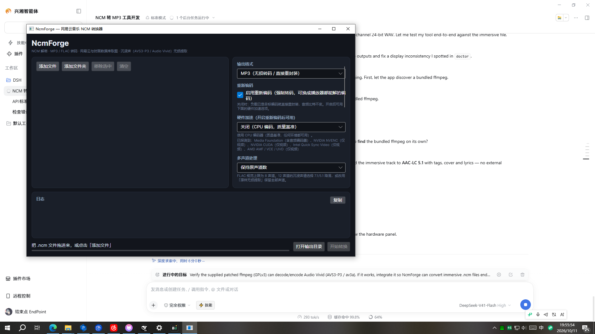

# NcmForge

**网易云音乐 `.ncm` 解密与转码工具**

[](https://github.com/112012201/ncmforge/actions/workflows/ci.yml)
[](LICENSE)
[](https://dotnet.microsoft.com/)

.NET 8 + Avalonia 构建，可打包为**自带 .NET 运行时的多文件发布包**，Windows / Linux / macOS 通用。

- **解密**：完整的 NCM 容器解析（AES-128-ECB 密钥层 + 元数据层 + RC4 风格音频密钥流）
- **转码**：MP3 / FLAC / AAC / ALAC / WavPack / Opus / TrueHD / E-AC-3 / DTS，自动区分「重封装」与「重新编码」
- **编码降级梯**：重新编码时按 `WavPack → TrueHD → E-AC-3 → DTS → FLAC → ALAC → Opus → AAC-LC → MP3` 逐档尝试，降级时在界面底部给出明确警告。WavPack 排第一是因为**实测只有它能无损承载全部 12 声道**
- **封面**：网易云官方优先，iTunes / Deezer / Cover Art Archive 兜底，写入 MP3（ID3v2 APIC）、FLAC（PICTURE）、MP4（`covr`）或 Matroska
- **歌词**：读取同名 `.lrc`（支持网易云 JSON 混合格式与 GBK 编码），写入 USLT / FLAC `LYRICS` / MP4 `©lyr`
- **沉浸声**：识别并解码 AVS3-P3（Audio Vivid / 菁彩声），12 声道 7.1.4 完整支持



> **免责声明**：本软件仅用于个人对**自己合法拥有**的音频文件做格式转换与备份。它不提供、
> 不托管、不分发任何音乐作品，也不绕过任何付费或会员权限。音频版权归原始权利人所有。
> 使用前请阅读 [DISCLAIMER.md](DISCLAIMER.md)。


---

## 一、逆向出来的容器格式

`.ncm` 没有公开规范，以下布局是本项目从真实文件与写入器双向验证得到的。

```
偏移        长度            内容
0x00        8               "CTENFDAM" 魔数
0x08        2               保留（01 70）
0x0A        4               密钥块长度（小端）
0x0E        keyLen          密钥块
            +4              元数据块长度（小端）
            +metaLen        元数据块
            +4              CRC32
            +5              保留字节
            ...             负载区（见下）
```

**密钥块**：逐字节 `^ 0x64` → AES-128-ECB 解密（固定密钥 `hzHRAmso5kInbaxW`）→ 去 PKCS#7 填充 → 去掉 17 字节前缀 `neteasecloudmusic`，剩下的就是每个文件各自的音频密钥。

**元数据块**：逐字节 `^ 0x63` → 去掉 22 字节前缀 `163 key(Don't modify):` → base64 解码 → AES-128-ECB 解密（固定密钥 `#14ljk_!\]&0U<'(`）→ 去填充 → 去掉 6 字节前缀 `music:` → UTF-8 JSON。

**音频负载**：用一个由密钥派生、周期为 256 字节的密钥流按位异或。参考实现每字节做 4 次关联查表：

```c
j = (i + 1) & 0xFF;
mask = box[(box[j] + box[(box[j] + j) & 0xFF]) & 0xFF];
```

`j` 只取决于 `i mod 256`，所以整条密钥流就是一个 256 字节的循环表。本项目据此预计算掩码表，解密退化成一次查表异或（`NcmKeystream`），并用单元测试锁住「分块解密 == 整体解密」这一性质。

### 负载区有两种布局

| 布局 | 结构 | 出现场景 |
|---|---|---|
| `Standard` | `[音频]` | 旧版下载 |
| `AfterEmbeddedImage` | `[uint32 封面长度][封面图][音频]` | **当前主流**，封面以明文内嵌 |
| `Scanned` | 靠签名扫描定位 | 兜底 |

第二种布局是本项目在分析真实沉浸声文件时发现的：文档化的 9 字节尾部之后并不是音频，而是一段**明文 JPEG**。解析器先做结构判断（`uint32` 长度 + 图片魔数），再对音频起点做签名校验。

> **本批 18 个样本全部是 `AfterEmbeddedImage` 布局。** 只按旧文档实现会把这些文件全部解错。

扫描兜底只接受**无歧义签名**（FLAC / ftyp / OggS / RIFF / ID3 / ADTS），因为杜比的两字节同步字在 14 MB 数据里会偶然出现几十次。

---

## 二、关于环绕声：实际是 AVS3-P3，不是 E-AC-3

你给出的两个 `.flac` 文件——`MONTAGEM 486.flac` 与 `City of Stars.flac`——**都不是 FLAC**：

```
magic: 00 00 00 1C 66 74 79 70 69 73 6F 6D   [....ftypisom]
codec_tag_string=av3a   channels=12   sample_rate=44100
format_name=mov,mp4,m4a,3gp,3g2,mj2
```

它们其实是 **MP4 容器，编码为 AVS3-P3（Audio Vivid / 菁彩声）**。`MONTAGEM 486.flac` 的 SHA256 是 `4957ED04…`，与本项目从 `.ncm` 解密出的负载**逐字节相同**。

所以「环绕音乐使用 EAC3 编码写入 FLAC」这个现象是真实存在的——**文件确实被错误地标成了 `.flac`**——但里面的编码不是 E-AC-3，而是 AVS3-P3。这解释了为什么播放器打不开这些「FLAC」。

内置的 `libncmdump.dll` 是原生 C++（用 TagLib），只导出 `CreateNeteaseCrypt`/`DestroyNeteaseCrypt`，同样不包含 E-AC-3 或 PCM 处理。也就是说，**没有任何参考实现支持 EAC3/PCM**；本批样本里也没有出现过这两种编码。

### 本工具的处理方式

| 情况 | 行为 |
|---|---|
| 负载是 AVS3-P3 | 默认**无损提取**为 `.m4a`（并写入完整标签与封面），或 `--extract-es` 抽出裸 `.av3a` |
| 配置了外部解码器 | 解码为 WAV 后由 ffmpeg 编码为 MP3 / FLAC |
| 负载是 MP3 / FLAC / AAC / AC-3 / E-AC-3 | 全功能支持，无需额外配置 |

**不会再把沉浸声负载命名为 `.flac`。** 扩展名按真实容器决定：MP4 → `.m4a`，裸流 → `.av3a`。

### 配置 AVS3-P3 外部解码器

```
python av3a_decoder.py "{input}" "{output}"
```

占位符：`{input}` `{output}` `{channels}` `{sampleRate}`，要求输出 WAV。「解码器输入」可选**裸基本流**（默认，参考解码器需要）或**解密后的原始负载**。

### 为什么我的播放器打不开？（实测结论）

把沉浸声文件丢进播放器，会看到两类报错，**两者都正常**：

| 播放器 | 报错 | 实际含义 |
|---|---|---|
| VLC | `VLC 无法解码格式"av3a" (No description for this codec)` | **容器解析成功**，VLC 正确读出了编码名 `av3a`，只是没有解码器 |
| PotPlayer | `File Source (Async.)::Output … 无法获取音频\|视频信息（不支持播放加密媒体）` | DirectShow 的 MP4 分离器不接受这个编码，在更早一步就失败了 |

VLC 那句报错其实是**好消息**：它说明文件结构完全正确。如果标签重写破坏了文件，VLC 连编码名都读不出来。

用命令确认文件的真实状态：

```bash
ncmforge doctor          # 报告本机 ffmpeg 到底能解哪些编码
```

```
=== decoder coverage ===
  yes  mp3      MP3 payloads
  yes  flac     FLAC payloads
  yes  eac3     Dolby Digital Plus (E-AC-3)
   NO  av3a     AVS3-P3 / Audio Vivid
  AVS3-P3: this build CANNOT decode Audio Vivid tracks.
```

`ffmpeg` 对这类文件的输出同样只差解码器：

```
Stream #0:0: Audio: none (av3a / 0x61337661), 44100 Hz, 7.1.4, 832 kb/s
```

`Audio: none` = 没有解码器；`7.1.4` 是它自己推断出的声道布局。**12 声道正是 7.1.4**（`FL-FR-FC-LFE-BL-BR-SL-SR-TFL-TFR-TBL-TBR`）。

### 想真正播放 / 转码，有三条路

> **本软件已内置可用的 AVS3-P3 解码器。** 发布包在 `tools/ffmpeg/` 下随附了一个带 `libarcdav3a`
> 解码器的 ffmpeg 构建（`AV3a decoder by ArcVideo`），因此沉浸声文件**开箱即可转码**，无需任何
> 额外配置。`ncmforge doctor` 会显示：
>
> ```
>   yes  av3a           AVS3-P3 / Audio Vivid
>   AVS3-P3: this build can decode immersive Audio Vivid tracks directly.
> ```
>
> 实测：`City of Stars` 的 12 声道沉浸声 → AAC-LC **5.1** / FLAC **7.1** / MP3 立体声，标签、
> 封面、歌词全部写入，解码校验 stderr 为 0。

1. **网易云音乐客户端**——它自带 AVS3-P3 解码器，本机已安装，是零成本方案。

   这一点可以直接验证：客户端自带的 `avcodec-58.dll` 里就有这个解码器条目——

   ```
   avs3p3_3d_audio
   AVS3-P3 3D Audio/Audio Vivid bitstream
   ```

   也就是说网易云用的是**打过补丁的 ffmpeg**（版本串 `FFmpeg version 5c4c25e`），只是它不提供独立的 `ffmpeg.exe`，所以外部程序没法直接调用。

2. **换一个带 AV3A 解码的播放器**：
   - Windows：[mpv-Yaozhi](https://github.com/Yaozhil/mpv-Yaozhi) —— 明确支持 AV3A / Audio Vivid 解码，并文档化了 5.1.4 / **7.1.4（12ch）** / 9.1.4 / 9.1.6 的声道顺序
   - macOS：[nilaoda/iina-avs](https://github.com/nilaoda/iina-avs/releases) —— 把 AVS+/AVS2/AVS3/**AV3A** 解码器融进了 FFmpeg 8.1 + libmpv

3. **让本工具转出 MP3 / FLAC**——需要一条能输出 WAV 的解码命令。带 AV3A 解码的 mpv 可以直接充当这个角色：

   ```
   ncmforge convert immersive.ncm --format flac --surround 71 ^
     --decoder "mpv.com --no-video --o=\"{output}\" \"{input}\""
   ```

   > 该模板用的是 mpv 的[编码模式](https://github.com/mpv-player/mpv/blob/master/DOCS/man/encode.rst)（`--o=` 加输出文件，格式由扩展名决定）。不同整合包的入口名可能不同（`mpv.com` / `mpv.exe`），请按本机实际调整。

   如果拿到的是**已带 AVS3 解码器的 ffmpeg**，则连外部解码器都不需要——直接 `--ffmpeg <路径>` 指向它即可，`doctor` 会显示 `yes avs3p3`。

   工具是按实际二进制**探测**解码能力，而不是靠硬编码名单；匹配用的是**子串**而不是精确名，所以像 `avs3p3_3d_audio` 这种无法预测的命名也能识别。万一仍然没匹配上，可用 `--assume-ffmpeg-decodes` 强制转码。

---

## 三、编解码覆盖（对照 18 个真实样本）

| 容器 | 编码 | 数量 | fourcc | 声道 | 处理路径 |
|---|---|---|---|---|---|
| FLAC | FLAC | 11 | — | 2 | 重封装，或 ffmpeg 转 MP3 |
| MP3 | MPEG-1 Layer III | 6 | — | 2 | 重封装（音频字节原样复制） |
| MP4 | **AVS3-P3 / Audio Vivid** | 1 | `av3a` | **12** | 无损提取 / 外部解码器 |

样本全部转换成功：`18/18`。

### 多声道与 FLAC 的 8 声道上限

FLAC 规范最多 8 声道，12 声道无法写入。界面与 CLI 都提供：

| 模式 | 说明 |
|---|---|
| 保持原声道数 | 仅当目标容器放得下；否则**明确报错**而不是静默降混 |
| 降混为 7.1（8 声道） | 写入 FLAC 的最宽布局 |
| 降混为 5.1（6 声道） | |
| 降混为立体声 | MP3 强制此模式 |

需要保留全部 12 声道时选「原样无损提取」。

---

## 四、歌词

网易云的 `.lrc` 是**混合格式**：前面若干行是 JSON 版权信息，后面是标准 LRC：

```
{"t":0,"c":[{"tx":"作词: "},{"tx":"Billie Joe Armstrong"}]}
{"t":1000,"c":[{"tx":"作曲: "},{"tx":"Green Day"}]}
[00:17.640]Do you know what's worth fighting for'
```

本工具两种都解析，并归一化为标准 LRC 后写入：

| 格式 | 写入位置 |
|---|---|
| MP3 | `USLT` 帧（含时间戳；语言码按内容自动选 `chi`/`eng`） |
| FLAC | `LYRICS`（含时间戳）+ `UNSYNCEDLYRICS`（纯文本） |
| MP4 | `©lyr` 原子 |

编码检测顺序：BOM → 严格 UTF-8 → **GB18030**，因此中文 GBK 歌词文件不会乱码。

歌词文件查找顺序：同名 `.lrc` → 按元数据标题匹配 → 宽松包含匹配。

---

## 五、打包发布

发布采用**多文件布局**（而不是一个巨大的单文件 exe）——这样启动更快、不需要可写的 `%TEMP%`，
也便于把 ffmpeg 作为独立文件随附：

```powershell
powershell -ExecutionPolicy Bypass -File scripts\publish.ps1
powershell -ExecutionPolicy Bypass -File scripts\publish.ps1 -FfmpegDir "D:\ffmpeg-avs" -FfmpegInCli
powershell -ExecutionPolicy Bypass -File scripts\publish.ps1 -Rids linux-x64,osx-arm64
powershell -ExecutionPolicy Bypass -File scripts\publish.ps1 -SingleFile          # 仍可选单文件
```

实测产物：

```
dist\win-x64\NcmForge.Gui    219 个文件   209.5 MB
    NcmForge.exe                             0.1 MB   ← 主程序本身很小
    tools/ffmpeg/ffmpeg.exe                113.6 MB   ← 随附的解码器
dist\win-x64\NcmForge.Cli    190 个文件   184.4 MB
```

| 参数 | 说明 |
|---|---|
| `-FfmpegDir <目录>` | 把该目录下的 ffmpeg 复制到 `<app>/tools/ffmpeg/` |
| `-FfmpegInCli` | CLI 也随附 ffmpeg（默认只给 GUI，CLI 保持精简） |
| `-WithFfprobe` | 额外复制 ffprobe（转换并不需要，再多 ~110 MB） |
| `-SingleFile` | 改回单文件 exe 布局 |

### ffmpeg 的查找顺序

`--ffmpeg` 参数 → `NCMFORGE_FFMPEG` 环境变量 → **随附的 `tools/ffmpeg/`（含上一级目录的
`tools/ffmpeg/`）** → `PATH` → 常见安装位置。

随附的那一份**优先于 PATH**：把它打包进来，正是因为系统里那份做不了这件事。

### ⚠️ 许可证：随附的 ffmpeg 是 GPLv3

这一份 ffmpeg 以 **GNU GPLv3** 分发（见 `tools/ffmpeg/COPYING.GPLv3.txt`）。它以**独立进程**被调用，
与 NcmForge 属于"聚合"而非派生作品，因此 **NcmForge 自身不必采用 GPL**；但再分发这个二进制时，
分发者仍需保留许可证全文、并提供对应源代码的获取方式。

详细说明写在 `tools/ffmpeg/NOTICE.txt` 里。如果你不需要沉浸声转码，**直接删掉 `tools/ffmpeg/`
目录即可**，程序会回退到 PATH 上的 ffmpeg。使用单文件模式时，ffmpeg 会放在 exe **旁边**
（单文件模式必须把原生库解压到 `%TEMP%\.net`，把 ffmpeg 塞进去只会更糟）。


---

## 六、命令行

```bash
ncmforge doctor                                  # 本机 ffmpeg 的解码能力（含 AVS3-P3 检测）
ncmforge survey  <目录> [--recursive] [--json]   # 批量侦察：每个文件的布局/编码/声道
ncmforge inspect <file.ncm> [--dump <dir>]       # 单文件详情 + 内嵌封面
ncmforge crack   <file.ncm>                      # 暴力定位负载起点（复核新布局）
ncmforge extract-es <file.m4a> [out]             # 抽出裸基本流
ncmforge convert <file.ncm | 目录> [选项]
ncmforge pack    <音频> <out.ncm>                # 造测试样本
```

`convert` 选项：

| 选项 | 说明 |
|---|---|
| `--format <mp3\|flac\|auto\|copy>` | 目标格式，默认 `mp3`；`auto` 自动选通用编码 |
| `--reencode` | 强制重新编码（关闭时负载已是目标编码就直接重封装） |
| `--hw <auto\|off\|mf\|nvenc\|nvcuda\|qsv\|amf\|vaapi\|videotoolbox\|mediacodec\|v4l2>` | 优先使用的编码器族，仅在 `--reencode` 下生效 |
| `--surround <preserve\|stereo\|51\|71>` | 声道处理，默认 `preserve` |
| `--cover <none\|embedded\|online\|online+embedded>` | 封面来源 |
| `--lyrics <sidecar\|none>` | 是否写入同名 `.lrc`，默认 `sidecar` |
| `--bitrate <kbps>` | 有损码率（MP3 / AAC），默认 320 |
| `--out <目录>` | 输出目录 |
| `--ffmpeg <路径>` | 指定 ffmpeg（可指向带 AVS3 解码器的修补版本） |
| `--assume-ffmpeg-decodes` | 解码能力探测失败时仍强制转码 |
| `--decoder "<命令>"` | 外部解码器模板 |
| `--decoder-input <es\|payload>` | 交给外部解码器的内容 |
| `--extract-es` | 输出裸基本流而非原始容器 |
| `--recursive` | 递归子目录 |

示例：

```bash
# 普通曲目转 320k MP3，封面在线优先，写入歌词
ncmforge convert song.ncm --format mp3 --bitrate 320 --cover online+embedded --lyrics sidecar

# 沉浸声：无损提取并写入标签/封面/歌词（音频比特不变）
ncmforge convert immersive.ncm --format copy

# 沉浸声：抽裸 AVS3 流
ncmforge convert immersive.ncm --format copy --extract-es

# 沉浸声：外部解码器 + 降混 7.1 写入 FLAC
ncmforge convert immersive.ncm --format flac --surround 71 \
  --decoder "python av3a_decoder.py \"{input}\" \"{output}\""
```

---

## 七、重新编码与硬件加速

默认情况下，负载已经是目标编码时工具只做**重封装**——复制音频字节、只重写元数据，又快又无损。

打开「启用重新编码」后强制走转码，并解锁下面的硬件加速选项（界面里这一组只在开关打开后才出现）。

### 同一级别的编码替换

重新编码的目的是**兼容性**，不是压缩，所以绝不会把无损源转成有损：

| 源 | 声道 | 目标 | 理由 |
|---|---|---|---|
| 无损（FLAC / ALAC / PCM） | ≤ 8 | **FLAC** | 无损源 → 无损目标；FLAC 是兼容性最好的无损格式 |
| 无损 | > 8 | **AAC-LC 5.1** | FLAC 放不下（规范上限 8 声道） |
| 有损（MP3 / AAC / AVS3-P3 / E-AC-3 …） | ≤ 2 | **AAC-LC** | 兼容性优于 MP3，同码率质量更好 |
| 有损 | > 2 | **AAC-LC 5.1** | Windows / 移动端 / 各播放器通吃 |

目标覆盖 Windows Media Player、PotPlayer、VLC，以及 Linux / macOS 的常见播放器。

### 硬件加速：一个必须说清的结论

工具会**实测**本机 ffmpeg 支持哪些编码器族，而不是写死名单：

```bash
ncmforge doctor
```

```
=== hardware encoders ===
  mf       audio + video   aac_mf, ac3_mf, av1_mf, h264_mf, …
  nvenc    video only      av1_nvenc, h264_nvenc, hevc_nvenc
  cuda     video only      cuda
  qsv      video only      av1_qsv, h264_qsv, hevc_qsv, mjpeg_qsv, …
  amf      video only      av1_amf, h264_amf, hevc_amf
  vaapi    video only      av1_vaapi, h264_vaapi, hevc_vaapi, mjpeg_vaapi, …
```

**结论：NVENC / NVCUDA / QSV / VA-API / VCE(UVD) / VideoToolbox / MediaCodec / V4L2 全部是视频编码器**，对音频输出不起作用。ffmpeg 里唯一带**音频**编码器的是 Windows Media Foundation：

| 加速族 | 音频编码器 | 效果 |
|---|---|---|
| **Media Foundation** (`--hw mf`) | `aac_mf` / `mp3_mf` / `ac3_mf` | ✅ 真正加速音频编码 |
| NVENC / QSV / AMF / VA-API / VideoToolbox / MediaCodec / V4L2 | 无 | ❌ 仅视频；界面会明确提示"音频仍需 CPU 编码" |

`--hw auto` 会自动挑出唯一能加速音频的那一族（即 Media Foundation）。

加速编码失败时（驱动、编码档次、声道布局等）会**自动回退 CPU 编码器重试一次**，不会因为一个"优先项"而让转换失败。

```bash
# 自动选通用编码 + 优先硬件
ncmforge convert song.ncm --format auto --reencode --hw auto

# 明确用 Media Foundation
ncmforge convert song.ncm --format mp3 --reencode --hw mf

# 指向带 AVS3 解码器的修补版 ffmpeg，沉浸声即可直接转码
ncmforge convert immersive.ncm --format auto --reencode --ffmpeg "D:\patched-ffmpeg\bin"
```

---

## 八、架构

```
src/NcmForge.Core/          无 UI 依赖的核心库
  Ncm/                      容器读写
    NcmFile.cs              解析、负载定位、解密流
    NcmWriter.cs            容器写入（让格式可测可复现）
    NcmCrypto.cs            AES 密钥层 / 元数据层（加解密双向）
    NcmKeystream.cs         周期 256 的掩码表 + 相位感知异或
    NcmMetadata.cs          元数据（容错读取）
    NcmDecryptedStream.cs   可寻址的解密流，惰性解密
  Audio/
    AudioFormatDetector.cs  签名嗅探（含杜比 bsid 判别）
    Mp4/Mp4Probe.cs         ISO-BMFF 盒子遍历 → 取编码 fourcc
    Mp4/Mp4SampleExtractor.cs  采样表遍历 → 裸基本流
    Flac/FlacProbe.cs       STREAMINFO
    ImageProbe.cs           不依赖图像库读 JPEG/PNG 尺寸
  Lyrics/
    LyricDocument.cs        网易云 JSON 混合格式 + LRC 解析
    LyricLoader.cs          编码检测（BOM/UTF-8/GB18030）与文件查找
  Tagging/
    Id3v2Writer.cs          ID3v2.3（UTF-16）+ APIC + USLT
    FlacTagWriter.cs        VORBIS_COMMENT + PICTURE 重写
    Mp4TagWriter.cs         udta/meta/ilst 重建 + stco/co64 偏移修正
  Covers/                   网易云 / iTunes / Deezer / Cover Art Archive
  Pipeline/                 转换编排、外部解码器
  Tools/                    ffmpeg 定位与调用、HttpClient

src/NcmForge.Cli/           命令行（survey / inspect / crack / extract-es / convert / pack）
src/NcmForge.App/           Avalonia 桌面界面
tests/NcmForge.Tests/       71 个单元测试
scripts/publish.ps1         单文件自包含发布
```

### 三个刻意的设计决定

**重封装 vs 重新编码。** 负载已经是目标编码时，直接复制音频字节、只重写元数据——又快又无损。只有真的换编码或换声道数才走 ffmpeg。

**标签自己写，不交给 ffmpeg。** ffmpeg 先输出裸音频到临时文件，再由本项目的写入器写标签。这样「重封装」「转码」「无损提取」三条路径产出的标签结构完全一致，也便于单独测试。

**MP4 标签必须修正块偏移。** 给 MP4 加标签会让 `moov` 变大，其后所有字节后移，`stco`/`co64` 里的块偏移必须同步加上这个差值——否则文件结构看起来仍然合法，但每个采样都指向错误的字节。单元测试会**把音频抽出来逐字节比对**来锁住这一点。

---

## 九、验证结果

**真实文件（`MONTAGEM 486.ncm`、`City of Stars.ncm`）**

- 元数据完整解出；内嵌封面正确提取
- 负载定位到 `0x1DE43`，识别为 12 声道 AVS3-P3
- 无损提取与手工解密 **SHA256 完全一致**
- 裸流提取 **10,765 个采样**，与 `ffprobe nb_frames` 吻合

**批量样本（18 个）**

- `18/18` 转换成功：11 个 FLAC→MP3 转码、6 个 MP3 重封装、1 个沉浸声无损提取
- 全部识别为 `AfterEmbeddedImage` 布局

**MP4 标签（在真实沉浸声文件上）**

- 写入 `©nam ©ART ©alb aART ©cmt ©lyr covr` 七个原子
- **保留原文件自带的原子**：NetEase 的沉浸声 MP4 本身带 `trkn`(track=27) 与 `©too`(encoder)，重写后会合并保留而不是被整块丢弃
- 无标签可写时**原样返回** moov，不会因为重写而悄悄丢掉原有元数据
- 标签重写前后抽出裸流 **SHA256 完全一致**（音频比特不变）
- `ffprobe` 读出全部标签，封面识别为 `attached_pic=1`

**播放器报错定位**

- VLC 报 `无法解码格式"av3a"`、PotPlayer 报 DirectShow `不支持播放加密媒体`——**均为缺少 AVS3-P3 解码器**，非文件损坏
- 反证：VLC 能读出编码名 `av3a`、ffmpeg 能读出 `44100 Hz, 7.1.4, 832 kb/s`，说明容器结构正确
- 我的标签重写**没有**引入 `timescale not set`：该警告在未重写的原文件上不出现，但 **ffmpeg 自己生成的带封面 MP4 同样会出现**；且音频流 `time_base=1/44100`、`duration_ts=11023360` 重写前后完全一致

**歌词**

- 真实 `.lrc`（49 行、含 JSON 版权行）解析并归一化
- `ffprobe` 读出 `lyrics-eng` / `lyrics-chi`，内容正确
- MP3 / FLAC 解码全程 `ffmpeg -v error` **stderr 为空**

**E-AC-3 与 PCM（本批样本未出现，用合成容器验证）**

| 输入 | 目标 | 结果 |
|---|---|---|
| E-AC-3 5.1 (`bsid=16`) | FLAC | **6 声道完整保留** |
| E-AC-3 5.1 | MP3 | 降混为 2 声道 |
| RIFF/WAVE PCM | FLAC | 正常转码 |

四个输出全部 `ffmpeg -v error` 无告警。

**单文件发布**

- 两个 exe 各自单独拷进空目录，脱离构建环境运行成功
- CLI 在空目录中对 18 个样本 `survey` 全部通过
- GUI 在空目录中启动并正常渲染

**测试**：71 个单元测试全部通过。

---

## 十、已知限制

- **AVS3-P3 / Audio Vivid 无法用主流播放器解码**——这是编码器生态问题。见第二节：用网易云客户端、带 AV3A 的播放器，或配外部解码器转码。
- 12 声道无法写入 FLAC（规范上限 8）；请降混或无损提取。
- 本批 18 个真实样本中**未出现 E-AC-3 或 PCM 负载**；两者的检测与转码链路已用合成容器验证通过，但缺少真实样本佐证。
- 仅处理 `.ncm`；已经是 MP3/FLAC 的文件无需转换。
- `pack` 生成的容器使用随机密钥，仅供测试。
- 单文件 EXE 首次启动需要可写的 `%TEMP%`（见第五节）。

## 十一、合规提示

本项目仅解密你自己合法获得的文件，用于格式转换与个人备份。请遵守网易云音乐的服务条款与当地法律，不要用于传播受版权保护的内容。
